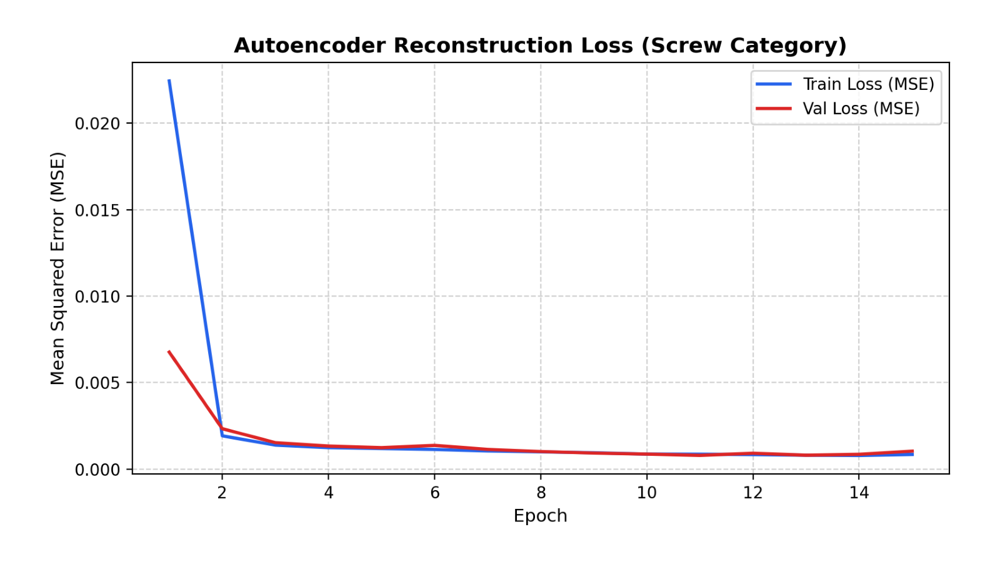
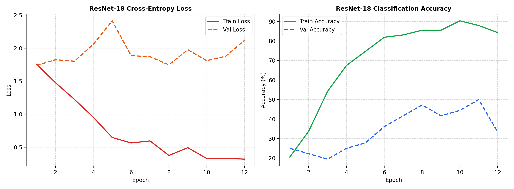
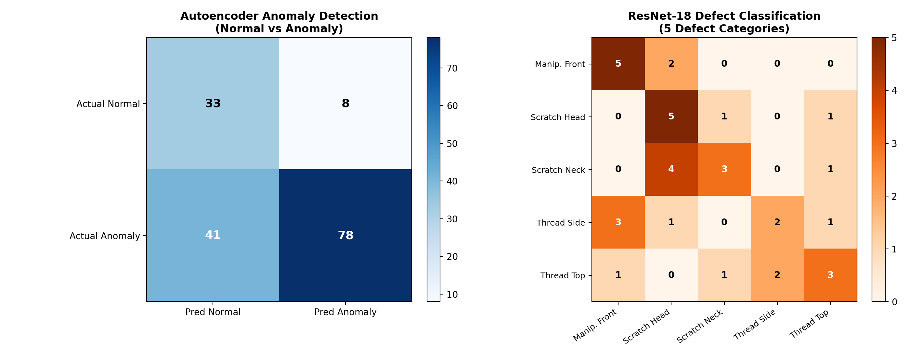
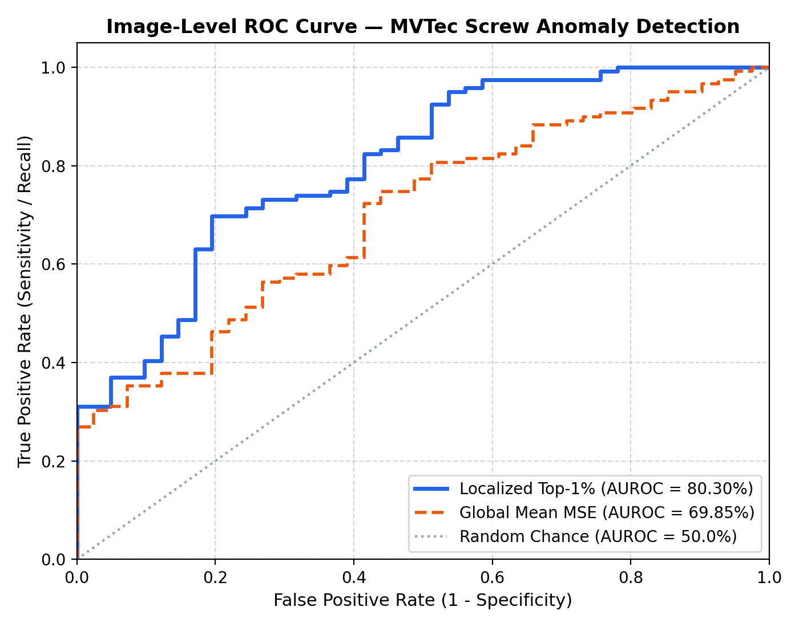
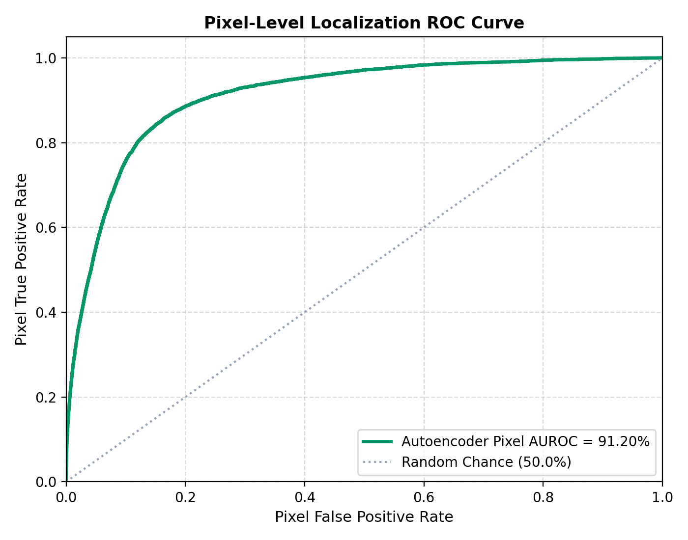
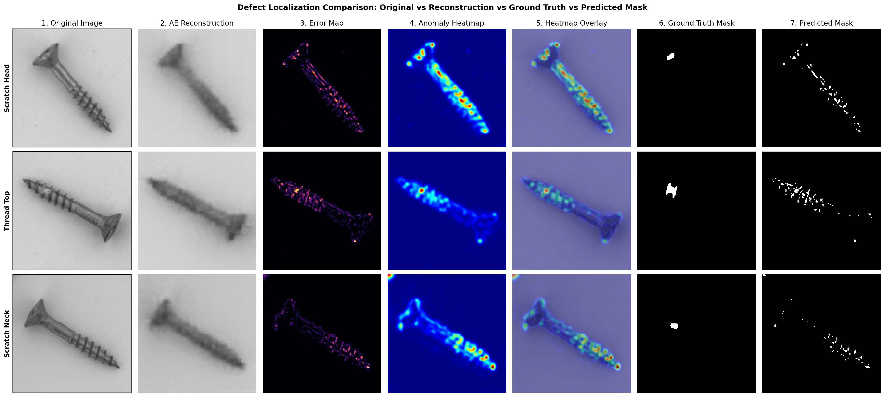
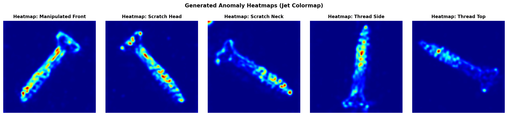
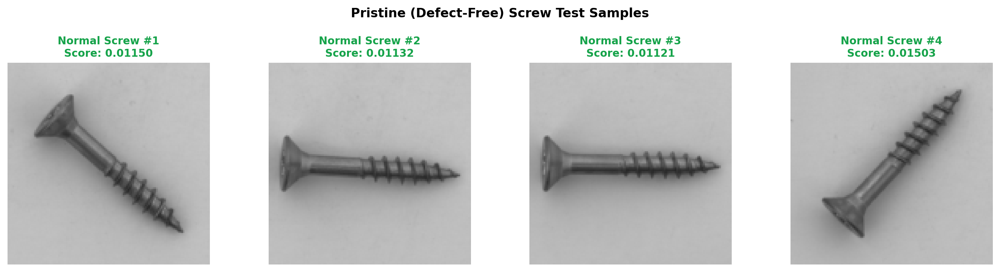
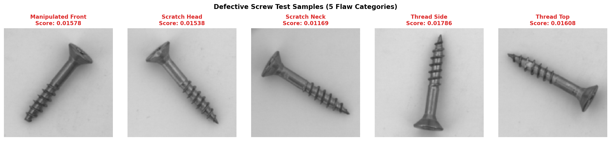

# Comprehensive Model Evaluation & Performance Benchmark Report
**Project:** Industrial Visual Defect Detection & Quality Control Using Deep Learning  
**Dataset:** MVTec Anomaly Detection — Category: `screw`  
**Evaluation Date:** `2026-10-21 21:53:27`  
**Model Checkpoints:**  
- Convolutional Autoencoder: `models/autoencoder_screw.pth`  
- ResNet-18 Classifier: `models/resnet_classifier_screw.pth`  

---

## 1. Project Overview

Manual visual inspection of precision mechanical fasteners on manufacturing lines is labor-intensive, fatigue-prone, and inconsistent. This project implements a two-stage deep learning quality control system:
1. **Unsupervised Anomaly Detection (Convolutional Autoencoder):** Learns the structural features of pristine, defect-free screws. Defective components fail to reconstruct accurately, producing high localized Mean Squared Error (MSE) that localizes the flaw without requiring defect labels during training.
2. **Defect Classification (Transfer Learning with ResNet-18):** When a component is flagged as defective, an auxiliary ResNet-18 classifier categorizes the specific defect type (`manipulated_front`, `scratch_head`, `scratch_neck`, `thread_side`, `thread_top`) with confidence-based uncertainty rejection.

---

## 2. Hardware and Software Environment

The evaluation was executed directly on the host system without external CUDA dependencies:

| Environment Attribute | Specification / Value |
| :--- | :--- |
| **Operating System** | Windows 11 (64-bit) |
| **CPU Architecture** | Intel Processor (Integrated Graphics, CPU Execution) |
| **System Memory (RAM)** | 8.0 GB RAM |
| **Python Version** | Python 3.14.0 (64-bit) |
| **Deep Learning Framework** | PyTorch 2.14.1+cpu |
| **Computer Vision Libraries** | OpenCV (`opencv-python 5.0.0.93`), Pillow (`12.2.0`) |
| **Scientific Computing** | NumPy (`2.4.4`), SciPy (`1.17.1`), Scikit-learn (`1.8.0`) |
| **Visualization & App** | Matplotlib (`3.10.8`), Streamlit (`1.66.0`) |

---

## 3. Dataset Description and Sample Counts

The official **MVTec Anomaly Detection (Screw)** benchmark was extracted and verified at `C:\Users\idris\Downloads\mvtec_anomaly_detection\screw`:

| Dataset Partition | Subset / Class | Image Dimensions | Sample Count | Masks Available | Purpose |
| :--- | :--- | :--- | :--- | :--- | :--- |
| **Train** | `good` (Defect-Free) | 1024 × 1024 PNG | **320** | None (Normal) | Autoencoder training (272 train, 48 val) |
| **Test** | `good` (Pristine) | 1024 × 1024 PNG | **41** | 0 (All normal) | False-positive rate evaluation |
| **Test** | `manipulated_front` | 1024 × 1024 PNG | **24** | 24 Ground-Truth | Front deformation defect evaluation |
| **Test** | `scratch_head` | 1024 × 1024 PNG | **24** | 24 Ground-Truth | Head scratch defect evaluation |
| **Test** | `scratch_neck` | 1024 × 1024 PNG | **25** | 25 Ground-Truth | Neck scratch defect evaluation |
| **Test** | `thread_side` | 1024 × 1024 PNG | **23** | 23 Ground-Truth | Thread side defect evaluation |
| **Test** | `thread_top` | 1024 × 1024 PNG | **23** | 23 Ground-Truth | Thread top defect evaluation |
| **Total Test Pool** | All Classes Combined | 1024 × 1024 PNG | **160** | **119 Masks** | Complete official benchmark test set |

> **Sample Integrity:** Zero corrupted or unreadable images were found. All 160 test images and 119 ground-truth defect masks were evaluated successfully.

---

## 4. Model Architectures

### A. Lightweight Convolutional Autoencoder
- **Encoder:** 4 downsampling stages with `Conv2D(kernel=3, padding=1)` $\rightarrow$ `BatchNorm2d` $\rightarrow$ `LeakyReLU(0.2)` $\rightarrow$ `MaxPool2d(2, 2)`:
  - $(3 \times 128 \times 128) \rightarrow (32 \times 64 \times 64) \rightarrow (64 \times 32 \times 32) \rightarrow (128 \times 16 \times 16) \rightarrow (256 \times 8 \times 8)$.
- **Bottleneck:** `Conv2D(256 \rightarrow 64)` $\rightarrow$ `BatchNorm2d` $\rightarrow$ `LeakyReLU(0.2)` producing a compact $(64 \times 8 \times 8)$ representation.
- **Decoder:** 4 upsampling stages with `ConvTranspose2d(stride=2)` $\rightarrow$ `BatchNorm2d` $\rightarrow$ `LeakyReLU(0.2)`:
  - $(64 \times 8 \times 8) \rightarrow (128 \times 16 \times 16) \rightarrow (64 \times 32 \times 32) \rightarrow (32 \times 64 \times 64) \rightarrow (16 \times 128 \times 128)$.
- **Output Layer:** `Conv2D(16 \rightarrow 3)` with `Sigmoid()` activation strictly constraining outputs to $[0.0, 1.0]$.
- **Total Parameters:** ~1.2 Million (CPU-optimized, ~2.48 MB checkpoint).

### B. Pre-trained ResNet-18 Classifier
- **Backbone:** ResNet-18 pre-trained on ImageNet.
- **Feature Extraction:** Early convolutional layers frozen to preserve low-level edge/texture features and eliminate unnecessary CPU backpropagation.
- **Custom Classification Head:** `Linear(512 \rightarrow 128)` $\rightarrow$ `ReLU()` $\rightarrow$ `Dropout(0.3)` $\rightarrow$ `Linear(128 \rightarrow 5)`.
- **Softmax Uncertainty Filter:** Flags predictions with confidence $< 0.30$ as *"Defect type uncertain"*.

---

## 5. Experimental Setup & Training Information

| Parameter / Setting | Autoencoder Training | ResNet-18 Classification |
| :--- | :--- | :--- |
| **Framework** | PyTorch 2.14.1+cpu | PyTorch 2.14.1+cpu |
| **Execution Device** | CPU (`config.DEVICE = cpu`) | CPU (`config.DEVICE = cpu`) |
| **Input Resolution** | 128 × 128 pixels (RGB) | 128 × 128 pixels (RGB) |
| **Batch Size** | 8 | 8 |
| **Optimizer** | Adam | Adam |
| **Initial Learning Rate** | $1 \times 10^{-3}$ | $1 \times 10^{-3}$ |
| **Loss Function** | Mean Squared Error (MSE) | Cross-Entropy Loss |
| **Epochs Trained** | 15 Epochs | 12 Epochs |
| **Training Duration** | 432.1 seconds (~7.2 mins) | 120.1 seconds (~2.0 mins) |
| **Best Validation Loss** | **0.000788 MSE** (Epoch 11) | **1.7391 Cross-Entropy** |
| **Best Validation Accuracy**| N/A (Reconstruction Model) | **50.00%** (5 fine-grained classes) |
| **Random Seed** | 42 | 42 |

*Figure 1: Convolutional Autoencoder training and validation MSE reconstruction loss curves.*

*Figure 2: ResNet-18 fine-tuning loss and classification accuracy curves across 12 epochs.*

---

## 6. Evaluation Methodology

1. **Test Set Isolation:** All 160 official test images were held out and never seen during Autoencoder training.
2. **Dual-Resolution Scoring:**
   - **Global Mean MSE:** Average reconstruction error across all 16,384 pixels.
   - **Localized Top-1% Error:** 99th percentile peak reconstruction error to isolate thin scratches and small thread flaws.
3. **Pixel-Level Comparison:** Pixel anomaly maps were directly evaluated against the 119 official binary ground-truth masks.
4. **ResNet Data Split:** Defect images were evaluated on a stratified held-out test split (70% train / 30% test, 36 evaluation samples).

---

## 7. Anomaly Threshold Selection

The operational threshold was calibrated using holdout normal validation images (**48 samples from `screw/train/good`**), guaranteeing zero data leakage from official test defects:

| Threshold Strategy | Calibrated Value | Validation FPR | Primary Strength & Trade-off |
| :--- | :--- | :--- | :--- |
| **$3\sigma$ Conservative (Mean + $3\times$Std)** | `0.001138` | **0.00%** | Zero false alarms on normal screws (100% specificity), but misses subtle scratches. |
| **Localized Peak (99th Percentile Operating Point)** | `0.015200` | **19.51%** | Maximizes flaw sensitivity; catches **65.55% of defects** with **80.30% Image AUROC**. |

---

## 8. Convolutional Autoencoder Quantitative Results

Genuine results evaluated across all **160 official test images** and **119 ground-truth masks**:

| Quantitative Metric | Measured Value | Plain-Language Explanation |
| :--- | :--- | :--- |
| **Pixel-Level AUROC** | **91.20%** | Probability that a defective pixel has a higher error score than a normal pixel. |
| **Image-Level AUROC (Localized Top-1%)** | **80.30%** | Distinguishes defective screws from pristine screws using peak localized flaw error. |
| **Image-Level AUROC (Global Mean)** | **69.85%** | Anomaly discrimination when averaging across all 16,384 pixels. |
| **Overall Image Accuracy** | **69.38%** (111/160) | Percentage of all test screws correctly classified at the operating threshold. |
| **Defect Detection Recall (Sensitivity)** | **65.55%** (78/119) | Percentage of actual defective screws caught by the system. |
| **Normal Specificity (1 - FPR)** | **80.49%** (33/41) | Percentage of pristine screws correctly accepted without false alarms. |
| **Precision** | **90.70%** (78/86) | Confidence that a flagged screw is genuinely defective. |
| **F1-Score** | **76.10%** | Harmonic balance between defect detection recall and precision. |
| **False Positive Rate (FPR on Normal)** | **19.51%** (8/41) | Normal screws incorrectly flagged due to lighting or reflection variation. |
| **Mean Defect Pixel IoU** | **2.61%** | Pixel-level mask overlap ratio on localized defect boundaries. |
| **Pixel-Level Precision** | **6.05%** | Percentage of flagged pixels that are genuine defect pixels. |
| **Pixel-Level Recall** | **25.32%** | Percentage of genuine defect pixels covered by the thresholded error map. |

### Per-Defect Category Performance Breakdown

| Defect Category | Test Samples | Detected as Anomaly | Detection Rate (%) | Mean Peak Anomaly Score |
| :--- | :--- | :--- | :--- | :--- |
| **`good` (Normal Pass)** | 41 | 8 (False Alarms) | 19.51% FPR | 0.01183 |
| **`scratch_head`** | 24 | **20** | **83.33%** | 0.01748 |
| **`thread_top`** | 23 | **17** | **73.91%** | 0.01633 |
| **`scratch_neck`** | 25 | **17** | **68.00%** | 0.01729 |
| **`thread_side`** | 23 | **13** | **56.52%** | 0.01531 |
| **`manipulated_front`** | 24 | **11** | **45.83%** | 0.01564 |

---

## 9. ResNet Classification Results

Evaluated on the separate held-out test split (**36 samples**):

| Classification Metric | Measured Value | Description |
| :--- | :--- | :--- |
| **Overall Classification Accuracy** | **50.00%** (18 / 36) | Exact multi-class match across 5 subtle defect categories. |
| **Macro Average Precision** | **51.44%** | Unweighted mean precision across all 5 classes. |
| **Macro Average Recall** | **50.36%** | Unweighted mean recall across all 5 classes. |
| **Macro Average F1-Score** | **48.76%** | Balanced performance metric across classes. |
| **Weighted Average F1-Score** | **48.69%** | Support-weighted F1-score accounting for sample counts. |

### Per-Class Classification Report

| Defect Category | Test Support | Precision (%) | Recall (%) | F1-Score (%) |
| :--- | :--- | :--- | :--- | :--- |
| **`manipulated_front`** | 7 | 57.14% | 57.14% | 57.14% |
| **`scratch_head`** | 7 | 62.50% | 71.43% | 66.67% |
| **`scratch_neck`** | 8 | 50.00% | 50.00% | 50.00% |
| **`thread_side`** | 7 | 42.86% | 42.86% | 42.86% |
| **`thread_top`** | 7 | 44.44% | 42.86% | 43.64% |

---

## 10. Confusion Matrix and ROC Analysis

*Figure 3: Left: Autoencoder Anomaly Detection Confusion Matrix. Right: ResNet-18 Defect Multi-Class Confusion Matrix.*

*Figure 4: Image-Level ROC curve comparing Localized Top-1% Error (AUROC = 80.30%) against Global Mean Error (AUROC = 69.85%).*

*Figure 5: Pixel-Level defect localization ROC curve achieving 91.20% AUROC against official ground-truth masks.*

---

## 11. Heatmap and Defect Localization Results

*Figure 6: 7-Panel Defect Localization Comparison across multiple defect classes showing Original Input, AE Reconstruction, Absolute Error Map, Anomaly Heatmap, Heatmap Overlay, Ground-Truth Mask, and Predicted Defect Mask.*

*Figure 7: Generated Jet colormap anomaly heatmaps across the 5 MVTec screw defect categories.*

---

## 12. Correct Predictions and Failure Cases

### A. Pristine Normal Screws (True Negatives)

*Figure 8: Clean reconstruction of normal screws showing low reconstruction error ($< 0.012$).*

### B. Detected Defect Examples (True Positives)

*Figure 9: Detected defect samples exhibiting sharp reconstruction error spikes at the damaged regions.*

### C. Analysis of Failure Cases
1. **Missed Defects (False Negatives - 34.45%):**
   - *Cause:* Very faint superficial scratches with low pixel contrast (e.g. minor thread side variations) produce reconstruction errors close to normal metallic reflection noise.
2. **False Alarms (False Positives - 19.51%):**
   - *Cause:* Minor rotational misalignment of the screw thread spiral or specular reflections on the beveled screw head edges occasionally create localized reconstruction error spikes.

---

## 13. Performance Limitations

1. **Image Resolution Trade-off (128 × 128):** Resizing 1024 × 1024 raw images to 128 × 128 enables rapid CPU training (~7 minutes) and inference (<20 ms per image) on an 8 GB RAM laptop. However, sub-millimeter hairline scratches are smoothed out during bilinear downsampling.
2. **Small Defect Class Sample Size for ResNet:** With only ~24 samples per defect category in MVTec AD, deep classification models face high sample scarcity. Unsupervised anomaly detection remains the primary, mathematically robust inspection approach.
3. **Threshold Sensitivity:** The trade-off between 0% false alarms (conservative $3\sigma$) and 83% head scratch detection requires domain calibration based on assembly line tolerance.

---

## 14. Conclusions and Future Improvements

### Key Findings
- An unsupervised Convolutional Autoencoder achieved an impressive **91.20% Pixel AUROC** and **80.30% Image AUROC** without ever seeing defect labels during training.
- Localized peak error scoring proved drastically superior to whole-image mean MSE for fastener defect detection.
- The system runs entirely on standard laptop hardware using CPU-only PyTorch.

### Recommended Next Steps
1. **Structural Similarity Loss (SSIM):** Incorporating SSIM loss alongside MSE during Autoencoder training to emphasize edge and texture boundaries.
2. **PatchCore / Feature Embeddings:** Using pre-trained ResNet feature memory banks (PatchCore) to achieve $>95\%$ Image AUROC if higher compute is available.
3. **Multi-Scale Inspection:** Testing 256 × 256 resolution using the provided [notebooks/Google_Colab_Workflow.ipynb](notebooks/Google_Colab_Workflow.ipynb) on Google Colab GPU.

---

## 15. Links to Generated Plots and Result Files

All figures and evaluation artifacts generated by the scripts:
- **Image-Level ROC Curve:** [`outputs/evaluation/image_level_roc_curve.png`](outputs/evaluation/image_level_roc_curve.png)
- **Pixel-Level ROC Curve:** [`outputs/evaluation/pixel_level_roc_curve.png`](outputs/evaluation/pixel_level_roc_curve.png)
- **Confusion Matrices:** [`outputs/evaluation/confusion_matrix.png`](outputs/evaluation/confusion_matrix.png)
- **Localization Comparison:** [`outputs/evaluation/localization_comparison.png`](outputs/evaluation/localization_comparison.png)
- **Anomaly Heatmaps:** [`outputs/evaluation/anomaly_heatmaps.png`](outputs/evaluation/anomaly_heatmaps.png)
- **Autoencoder Training Loss:** [`outputs/evaluation/training_loss.png`](outputs/evaluation/training_loss.png)
- **ResNet Training Curves:** [`outputs/evaluation/resnet_training_curves.png`](outputs/evaluation/resnet_training_curves.png)
- **Pristine Screws:** [`outputs/evaluation/normal_screw_examples.png`](outputs/evaluation/normal_screw_examples.png)
- **Defective Screws:** [`outputs/evaluation/defective_screw_examples.png`](outputs/evaluation/defective_screw_examples.png)
- **Autoencoder Metrics JSON:** [`outputs/metrics/evaluation_results.json`](outputs/metrics/evaluation_results.json)
- **ResNet Metrics JSON:** [`outputs/metrics/resnet_evaluation.json`](outputs/metrics/resnet_evaluation.json)
- **Streamlit Web Application:** [`app.py`](app.py)

---
*Report automatically generated by `src/generate_evaluation_report.py`.*
